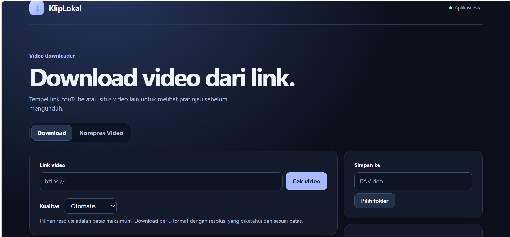

# KlipLokal

Aplikasi lokal untuk Windows yang menampilkan pratinjau video, mengunduh MP4 atau MP3, dan mengompres video langsung di laptop.

KlipLokal memakai [yt-dlp](https://github.com/yt-dlp/yt-dlp), [FFmpeg](https://ffmpeg.org/), dan [Playwright](https://github.com/microsoft/playwright-python) sebagai dependensi terpisah.

## Tampilan

[Unduh KlipLokal.zip](KlipLokal.zip)

## Jalankan

1. Ekstrak ZIP ke folder biasa, misalnya `D:\KlipLokal`.
2. Klik dua kali `Start.bat`. Setup pertama memasang Playwright ke lingkungan Python di dalam folder aplikasi.
3. Buka `http://127.0.0.1:8765` kalau halaman belum terbuka otomatis.
4. Tempel link YouTube atau situs video lain. Dashboard menampilkan judul, sumber, durasi, dan thumbnail jika tersedia.
5. Di **Simpan ke**, klik **Pilih folder** atau ketik path lengkap, misalnya `E:\Unduhan\Video`. Kolom kosong memakai folder bawaan `D:\Video`. Dashboard mengingat pilihan terakhir di browser.
6. Pilih **Unduh MP4** atau **Unduh MP3**. Pengaturan **Kualitas** berlaku untuk MP4. Folder tujuan dibuat jika belum ada dan bisa diakses.

Untuk memperbarui dari versi sebelumnya, tutup aplikasi lalu ekstrak ZIP ini ke folder aplikasi yang sama dan ganti file saat diminta.

Perlu Python 3.11+, yt-dlp, dan Chrome atau Microsoft Edge. FFmpeg dipakai jika yt-dlp perlu menggabungkan audio dan video. Kalau sebelumnya memasang yt-dlp lewat perintah WinGet yang menyertakan FFmpeg, pemasangan itu bisa langsung digunakan.

## Kompres video di laptop

1. Buka tab **Kompres Video**. Klik **Pilih video** atau ketik path lengkap file video.
2. Pilih **Kualitas** (Kecil, Seimbang, atau Tinggi) atau **Target ukuran** dalam MB. Pilih resolusi maksimum dan folder tujuan.
3. Klik **Kompres ke MP4** dan biarkan jendela CMD tetap terbuka. Progres, ukuran sebelum dan sesudah, serta dimensi hasil tampil di dashboard.

Kompres memakai FFmpeg dan FFprobe lokal tanpa upload. Output memakai MP4 (H.264 dan AAC jika sumber punya audio) dengan akhiran `_kompres`. File sumber tetap tersimpan. Mode target memakai dua tahap sehingga lebih lama dan hasil ukurannya bisa berbeda dari target. KlipLokal memproses satu download atau kompres pada satu waktu.

## Tangkap stream dari Chrome biasa

1. Di Chrome, buka `chrome://extensions`. Aktifkan **Developer mode**, klik **Load unpacked**, lalu pilih folder `Chrome-Extension` dari ZIP yang sudah diekstrak.
2. Buka situs di Chrome seperti biasa. Jika Cloudflare meminta verifikasi, selesaikan di tab itu.
3. Klik ikon puzzle → **KlipLokal Capture** → **Mulai tangkap**, lalu izinkan akses situs jika diminta. Video bisa dimuat dari domain yang berbeda dengan halaman.
4. Putar video utama. Jika videonya sudah telanjur diputar, refresh tab lalu putar lagi. Buka kembali ekstensi dan pilih stream yang cocok → **Kirim ke KlipLokal**.
5. Dashboard lokal akan terbuka dengan link terisi. Pastikan `Start.bat` masih berjalan, lalu pilih **Unduh MP4** atau **Unduh MP3** setelah pratinjau muncul.

Ekstensi mengamati stream di satu tab yang dipilih selama maksimal dua menit per sesi tangkap. Verifikasi Cloudflare dilakukan langsung di Chrome. Jika server stream sendiri menolak koneksi dari yt-dlp atau linknya sudah kedaluwarsa, download masih bisa gagal.

## Cara kerja

- Pratinjau membaca metadata melalui yt-dlp tanpa mengunduh file. Thumbnail bergantung pada data yang disediakan sumber.
- Jika pratinjau gagal, tombol **Pindai lewat browser** membuka Chrome atau Edge untuk mencari HLS (.m3u8), DASH (.mpd), atau video langsung.
- TikTok dan Instagram di luar cakupan.
- Satu permintaan download menangani satu video. Untuk URL playlist, aplikasi membatasi unduhan ke item pertama.
- Saat jendela pemindai terbuka, putar video utama. Setelah videonya berjalan, kembali ke dashboard dan klik **Cek stream**. Pilih stream berdasarkan durasi atau nama sebelum klik **Download stream pilihan**. Tombol **Batal** menghentikan pemindaian atau menutup daftar pilihan.
- Pemindai menutup tab pop-up yang dibuka oleh halaman dan menyaring beberapa pola URL iklan. Iklan yang diputar di player yang sama bisa tetap muncul dalam daftar, jadi cocokkan durasinya dengan video utama.
- **Otomatis** mengikuti pilihan format yt-dlp. Pilihan angka menetapkan batas maksimum untuk sisi terpendek video. Jika tidak ada format yang memenuhi batas atau sumber tidak menyertakan informasi resolusi, download berhenti. Resolusi file hasil tampil jika bisa dibaca oleh FFprobe. Gunakan link halaman atau playlist master untuk sumber yang menyediakan beberapa resolusi.
- Situs yang memerlukan login atau menggunakan DRM mungkin gagal. Link stream yang kedaluwarsa bisa dicoba ulang dari link halaman.
- Biarkan jendela CMD tetap terbuka selama proses. Dashboard hanya menerima koneksi dari laptop ini. Aplikasi tidak menyimpan riwayat link.
